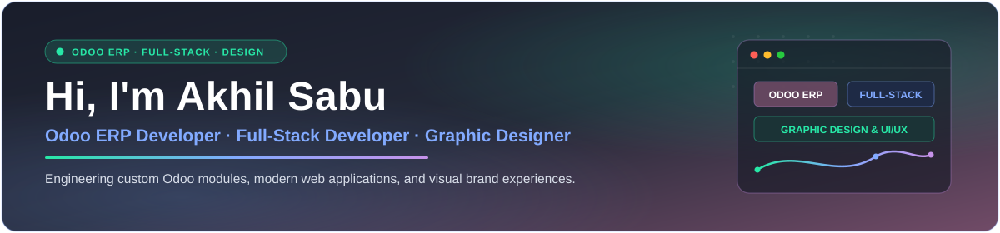
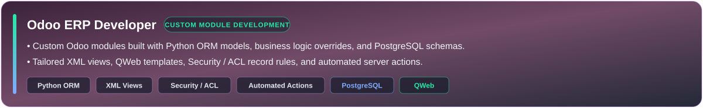
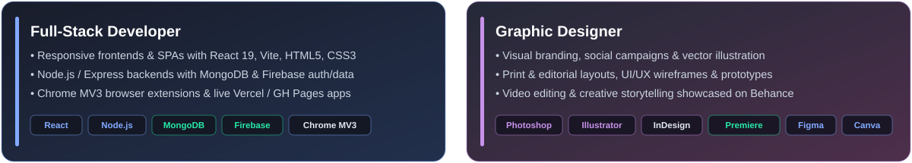
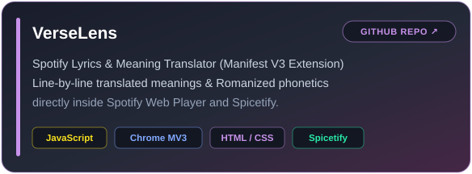
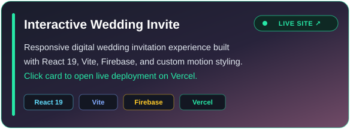
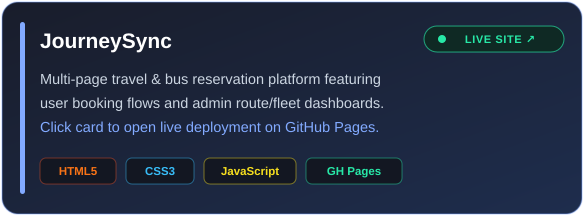
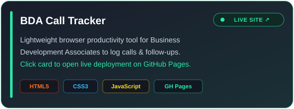

  

  
  
  
  
  

  

---

## 🧩 What I Do

  

 

  

---

## 🚀 About Me

- 💼 **Odoo ERP Developer:** Customizing Odoo with **Python ORM**, **XML views**, **Security / ACL**, **Automated Actions**, **QWeb** reports, and **PostgreSQL**.
- 💻 **Full-Stack Developer:** Building responsive web apps and extensions with **React, Vite, Node.js, Express, MongoDB, Firebase**, and **Chrome MV3**.
- 🎨 **Graphic Designer:** Designing visual brand identities, print layouts, UI/UX prototypes, and video edits in **Photoshop, Illustrator, InDesign, Premiere Pro, Figma, and Canva** — see my portfolio on **[Behance](https://behance.net/akhilsabu7)**.
- 📫 **Contact:** [akhilsabu2052003@gmail.com](mailto:akhilsabu2052003@gmail.com)

---

## 🛠️ Featured Public Projects

Click any live card to open the deployed web app directly, or use the source pills below to inspect the code.

  
  

  
  &nbsp;&nbsp;
  

 

  
  

  
  &nbsp;&nbsp;
  

---

## 🔄 Recently Updated Repositories

<!-- RECENT_REPOS:START -->

<strong>View 6 most recently updated public repositories (auto-synced daily)</strong>

- **[portfolio](https://github.com/AKHXI1/portfolio)** (`TypeScript` · updated `2026-11-28`) · [Repo](https://github.com/AKHXI1/portfolio)
- **[PingHR](https://github.com/AKHXI1/PingHR)** (`Python` · updated `2026-11-28`) · [Repo](https://github.com/AKHXI1/PingHR)
- **[wedding-invitation-](https://wedding-invitation-tan-seven.vercel.app)** (`CSS` · updated `2026-11-28`) · [Live Demo](https://wedding-invitation-tan-seven.vercel.app) · [Repo](https://github.com/AKHXI1/wedding-invitation-)
- **[Brio---your_pc_companion](https://github.com/AKHXI1/Brio---your_pc_companion)** (`JavaScript` · updated `2026-11-26`) · [Repo](https://github.com/AKHXI1/Brio---your_pc_companion)
- **[spotify-lyrics-translater](https://github.com/AKHXI1/spotify-lyrics-translater)** (`JavaScript` · updated `2026-10-26`) · [Repo](https://github.com/AKHXI1/spotify-lyrics-translater)
- **[call-tracker-for-Buisness-development-associates](https://github.com/AKHXI1/call-tracker-for-Buisness-development-associates)** (`HTML` · updated `2025-08-26`) — call tracker for Buisness development associates to mark there calls ,positives, neutrals, not interested & followups · [Repo](https://github.com/AKHXI1/call-tracker-for-Buisness-development-associates)

<!-- RECENT_REPOS:END -->

---

## 💻 Tech Stack & Tools

  

---

## 📊 GitHub Analytics

  
  

  

  

---

## ☕ Support My Work

If you find my projects helpful or enjoy what I build, feel free to support my creative journey!

  
  

  

