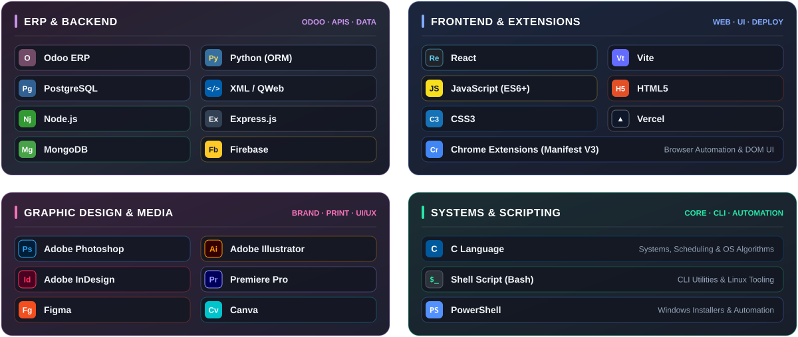

  

  
  
  
  
  

  

---

## 🧩 What I Do

  

 

  

---

## 🚀 About Me

- 💼 **Odoo ERP Developer:** Customizing Odoo with **Python ORM**, **XML views**, **Security / ACL**, **Automated Actions**, **QWeb** reports, and **PostgreSQL**.
- 💻 **Full-Stack Developer:** Building responsive web apps and extensions with **React, Vite, Node.js, Express, MongoDB, Firebase**, and **Chrome MV3**.
- 🎨 **Graphic Designer:** Designing visual brand identities, print layouts, UI/UX prototypes, and video edits in **Photoshop, Illustrator, InDesign, Premiere Pro, Figma, and Canva** — see my portfolio on **[Behance](https://behance.net/akhilsabu7)**.
- 📫 **Contact:** [akhilsabu2052003@gmail.com](mailto:akhilsabu2052003@gmail.com)

---

## 🛠️ Featured Public Projects

| Project | What It Does | Stack | Links |
| :--- | :--- | :--- | :--- |
| **[VerseLens](https://github.com/AKHXI1/spotify-lyrics-translater)** | Manifest V3 Chrome extension & Spicetify script showing line-by-line translated lyric meanings and Romanized phonetics on Spotify Web Player | JavaScript, Chrome MV3, HTML, CSS | [Repo](https://github.com/AKHXI1/spotify-lyrics-translater) |
| **[Interactive Wedding Invite](https://github.com/AKHXI1/wedding-invitation-)** | Modern, responsive digital wedding invitation web app deployed on Vercel | React 19, Vite, Firebase, CSS3 | [Live](https://wedding-invitation-tan-seven.vercel.app) · [Repo](https://github.com/AKHXI1/wedding-invitation-) |
| **[JourneySync](https://github.com/AKHXI1/journeySync)** | Multi-page travel & bus reservation platform with user booking flows and admin management dashboards | HTML5, CSS3, JavaScript | [Live](https://akhxi1.github.io/journeySync/login.html) · [Repo](https://github.com/AKHXI1/journeySync) |
| **[BDA Call Tracker](https://github.com/AKHXI1/call-tracker-for-Buisness-development-associates)** | Lightweight browser tool for Business Development Associates to log call outcomes and follow-ups | HTML5, CSS3, JavaScript | [Live](https://akhxi1.github.io/call-tracker-for-Buisness-development-associates/) · [Repo](https://github.com/AKHXI1/call-tracker-for-Buisness-development-associates) |

---

## 🔄 Recently Updated Repositories

Auto-updated daily via GitHub Actions whenever public repositories receive new pushes.

<!-- RECENT_REPOS:START -->
| Repository | Description | Language | Updated | Links |
| :--- | :--- | :--- | :--- | :--- |
| **[wedding-invitation-](https://github.com/AKHXI1/wedding-invitation-)** | — | CSS | 2026-11-26 | [Live](https://wedding-invitation-tan-seven.vercel.app) · [Repo](https://github.com/AKHXI1/wedding-invitation-) |
| **[spotify-lyrics-translater](https://github.com/AKHXI1/spotify-lyrics-translater)** | — | JavaScript | 2026-10-26 | [Repo](https://github.com/AKHXI1/spotify-lyrics-translater) |
| **[call-tracker-for-Buisness-development-associates](https://github.com/AKHXI1/call-tracker-for-Buisness-development-associates)** | call tracker for Buisness development associates to mark there calls ,positives, neutrals, not interested & followups | HTML | 2025-08-26 | [Repo](https://github.com/AKHXI1/call-tracker-for-Buisness-development-associates) |
| **[make-buisness-online](https://github.com/AKHXI1/make-buisness-online)** | — | CSS | 2025-08-22 | [Repo](https://github.com/AKHXI1/make-buisness-online) |
| **[kerala-tourism-website](https://github.com/AKHXI1/kerala-tourism-website)** | basics of HTML & CSS | HTML | 2025-08-22 | [Repo](https://github.com/AKHXI1/kerala-tourism-website) |
| **[mainproject-ideas](https://github.com/AKHXI1/mainproject-ideas)** | — | — | 2024-07-25 | [Repo](https://github.com/AKHXI1/mainproject-ideas) |
<!-- RECENT_REPOS:END -->

---

## 💻 Tech Stack & Tools

  

---

## 📊 GitHub Analytics

  
  

  

  

---

## ☕ Support My Work

If you find my projects helpful or enjoy what I build, feel free to support my creative journey!

  
  

  

